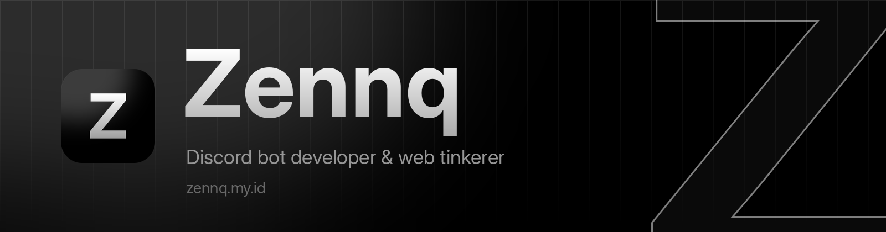

<div align="center">



<a href="https://zennq.my.id">
  
</a>

<br/>

<a href="https://zennq.my.id"></a>
<a href="https://discord.com/users/1121982034370371594"></a>
<a href="https://discord.gg/rbBvzyMzBh"></a>

</div>

<br/>

### About

```text
> whoami
a guy who builds bots
and reads manhwa

> what-i-do
Discord bots, websites,
and random web tinkering

> stack
JavaScript · HTML · CSS

> reading
too much manhwa
```

<br/>

### Tech

<div align="center">
  
</div>

<br/>

### Discord

<div align="center">
  <a href="https://discord.com/users/1121982034370371594">
    
  </a>
</div>

<br/>

### Contributions

<div align="center">
  
</div>


